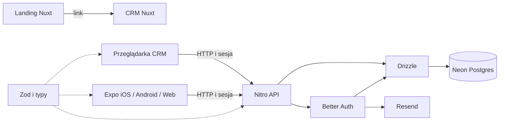

# Architektura

Landing, CRM i mobile są niezależnymi aplikacjami w jednym repozytorium. Wspólne pakiety opisują dane, usługi i motyw Nuxt UI. Warstwa `@seed/ui` nadaje aplikacjom web spójny styl inspirowany koonrad.dev. Domena produktu pozostaje po stronie nowego projektu.

```text
apps/landing        Nuxt + Vue + Nuxt UI
apps/crm            Nuxt + Vue + Nuxt UI + Nitro API
apps/mobile         Expo + React Native + Expo Router
packages/shared     kontrakty TypeScript i Zod
packages/db         Neon + Drizzle + migracje
packages/auth       Better Auth + integracja Expo
packages/email      Resend
packages/ui         wspólna warstwa motywu Nuxt UI
```



CRM pełni rolę backendu zarówno dla web, jak i mobile. Dzięki temu reguły dostępu, walidacja i logowanie pozostają w jednym miejscu. Landing nie potrzebuje dostępu do bazy.

`packages/shared` jest bezpieczny dla klientów. Pozostałe pakiety usługowe działają na serwerze. Mobilny i przeglądarkowy bundle nie zawiera danych dostępowych do Neon, Resend ani sekretu Better Auth.

## Dlaczego te elementy

Nuxt zapewnia routing, SSR i endpointy serwerowe. Nuxt UI daje wspólne komponenty formularzy i panelu bez budowania biblioteki od zera. Expo utrzymuje osobny interfejs natywny przy wspólnych kontraktach danych. Nie próbuje uruchamiać komponentów Vue w React Native.

Neon to PostgreSQL dostępny przez standardowe połączenie. Drizzle trzyma schemat w TypeScript i zapisuje zmiany jako migracje SQL. Better Auth zarządza użytkownikami, sesjami, hasłami i weryfikacją. Resend wysyła wiadomości potrzebne do weryfikacji i resetu hasła.

Turborepo uruchamia zadania workspace i cache buildów. Pakiety mają własne skrypty. Główny `package.json` łączy je w polecenia wygodne do pracy lokalnej i CI.

## Model danych i rozbudowa

Kontakt CRM należy do jednego użytkownika. Każdy endpoint odczytuje właściciela z sesji i filtruje zapytanie po jego identyfikatorze. Dodawanie organizacji, ról zespołowych czy wspólnej książki kontaktów wymaga świadomej zmiany modelu uprawnień.

Nową funkcję współdzieloną między web i mobile zacznij od kontraktu w `packages/shared`, potem endpointu CRM, a następnie klientów. Funkcja używana tylko przez jedną aplikację może pozostać w jej katalogu.

Starter nie wymaga Redis, kolejki, storage plików ani dostawcy AI. Dodaj je wtedy, gdy nowy projekt ma konkretną potrzebę. Utrzymuje to niewielką liczbę kont, sekretów i usług potrzebnych do pierwszego uruchomienia.
